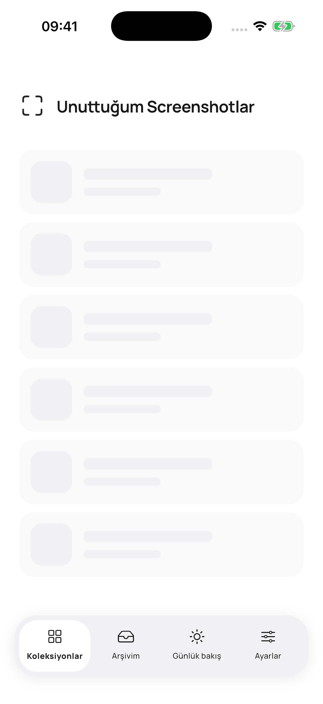
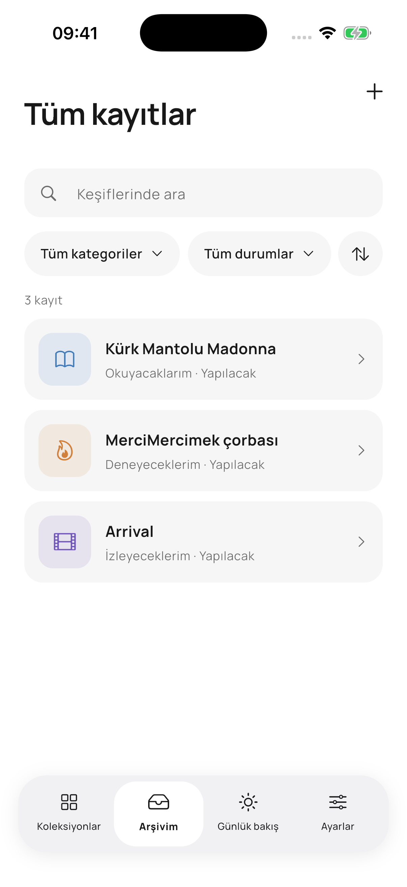
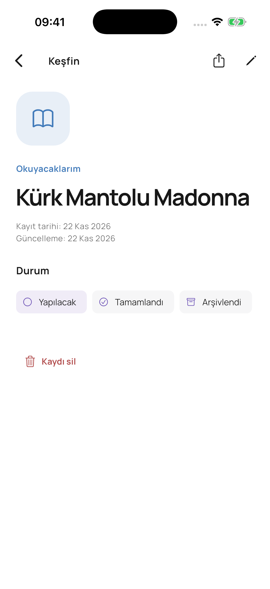
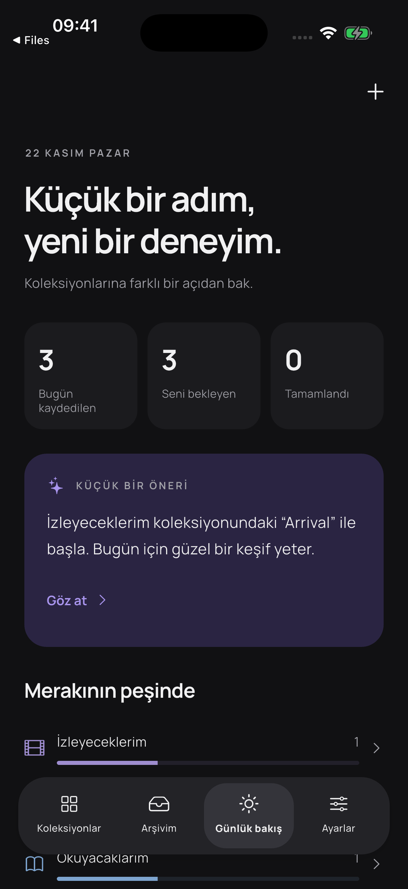
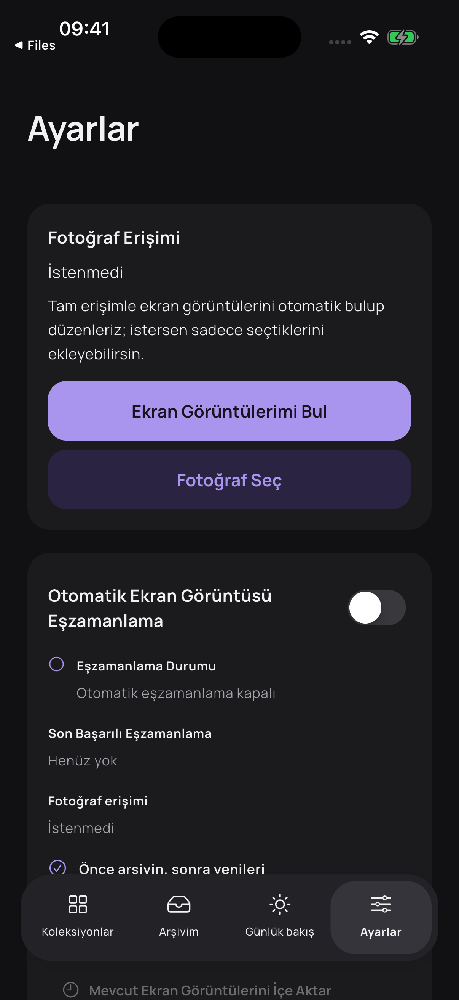
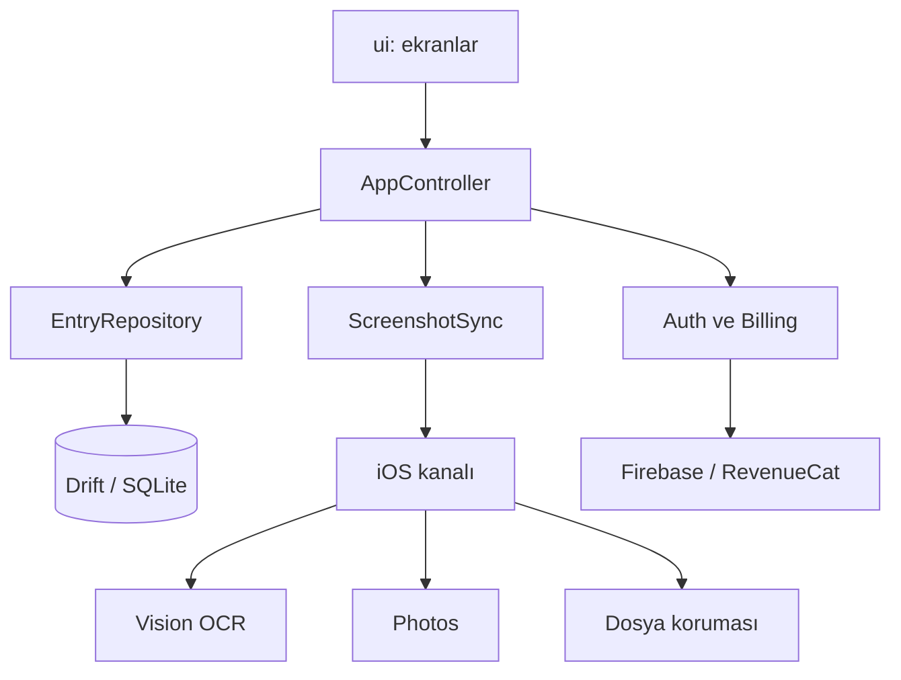

# Unuttuğum Screenshotlar

Kaydedip bir daha bakmadığın ekran görüntülerini otomatik bulan, metnini cihazda okuyan ve yapılacaklar listesine çeviren iOS odaklı Flutter uygulaması.

*A local-first Flutter app (iOS-focused) that finds your forgotten screenshots, reads them on-device and sorts them into things you want to do.*

<p align="center">
  
  
  
  
  
</p>

## Neler yapar?

- Ekran görüntülerini otomatik bulur (uygulama açıkken, izin verirsen).
- Metni cihazda tanır (Apple Vision) ve 8 koleksiyondan birine yerleştirir.
- Arama, filtre ve sıralama sunar.
- Kartları kaydırarak tamamlar veya silersin; işlem geri alınabilir.
- Günlük bakış ekranı, hâlâ yapılmamış kayıtları hatırlatır.
- Koyu mod, Türkçe ve İngilizce arayüz.
- İsteğe bağlı Google veya Apple ile giriş.
- İsteğe bağlı Pro abonelik (RevenueCat).

## Gizlilik ve güvenlik

- Veriler cihazdaki SQLite (Drift) veritabanında kalır.
- Metin tanıma cihazda çalışır; bulut yapay zekâ yoktur.
- Uygulama fotoğraflarını hiçbir zaman silmez veya değiştirmez.
- Yalnızca ekran görüntüleri okunur.
- Kopyalanan görseller EXIF ve konum bilgisinden arındırılıp uygulama alanında saklanır.
- Dosya koruması açıktır ve dosyalar yedekten hariç tutulur.
- Repoda sır yoktur: yapılandırma `--dart-define` ile verilir; CI'da gitleaks, yerelde pre-commit hook çalışır.

## Teknolojiler

| Katman | Teknoloji |
| --- | --- |
| Uygulama | Flutter 3.47 / Dart 3.13 |
| Veri | Drift + SQLite |
| Fotoğraf erişimi | photo_manager, PHPicker |
| Metin tanıma | Apple Vision (yerel Swift) |
| Giriş | Firebase Auth (Google, Apple) |
| Abonelik | RevenueCat (purchases_flutter) |
| Paylaşma / bağlantı | share_plus, url_launcher |
| Yerelleştirme | flutter_localizations, intl |
| CI | GitHub Actions |

## Mimari



## Kurulum

1. Bağımlılıkları ve yerelleştirme dosyalarını hazırla:

   ```bash
   flutter pub get
   flutter gen-l10n
   ```

2. Drift kodunu yalnızca şema değiştiyse yeniden üret (üretilmiş dosyalar repoda var):

   ```bash
   dart run build_runner build
   ```

3. Yapılandırma dosyasını oluştur ve yalnızca herkese açık değerleri doldur:

   ```bash
   cp config/release.public.example.json config/release.public.json
   ```

4. Çalıştır:

   ```bash
   flutter run --dart-define-from-file=config/release.public.json
   ```

   Yapılandırma olmadan da uygulama açılır; giriş ve Pro kapalı kalır.

5. Sır taramasını commit öncesi çalıştıran hook'u kur:

   ```bash
   sh tool/install_hooks.sh
   ```

Servis kurulumu için: [docs/MANUAL_AUTH_AND_SERVICE_SETUP.md](docs/MANUAL_AUTH_AND_SERVICE_SETUP.md)

## Testler

```bash
flutter analyze
flutter test
```

İsteğe bağlı: iOS yerel testleri, yeni bir simülatör oluşturup kullanıcı verisine dokunmadan çalışır.

```bash
./tool/test_ios_safely.sh
```

## Proje yapısı

```
lib/
├── application/   AppController, uygulama durumu
├── auth/          Firebase ile Google ve Apple girişi
├── billing/       RevenueCat, abonelik ve onay
├── config/        dart-define ile gelen yapılandırma
├── data/          Drift veritabanı, repository, fotoğraf ve OCR köprüleri
├── domain/        Kayıt, inceleme ve bağlantı modelleri
├── importing/     Elle seçilen görsellerin içe aktarımı
├── l10n/          Türkçe ve İngilizce metinler (.arb)
├── onboarding/    İlk açılış akışı
├── sync/          Ekran görüntüsü eşitleme ve sınıflandırma
└── ui/            Ekranlar, bileşenler, tasarım sistemi
```

Eski raporlar ve tasarım notları: [docs/history/](docs/history/)

Lisans: Tüm hakları saklıdır.
