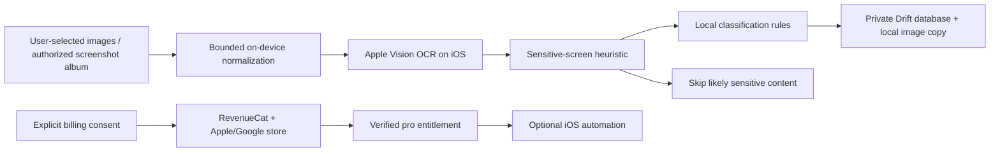

> Product/auth update: optional Firebase Authentication (Google/Apple identity only) is now implemented, without a screenshot backend or cloud AI. Basic automatic discovery is free; iOS Pro increases selected batches from 10 to 50. The AI no-cloud/no-quota findings below still apply; see MANUAL_AUTH_AND_SERVICE_SETUP.md for identity-service costs and current account-linked billing behavior.

# AI cost and privacy — 21 October 2026

## Actual shipped processing
Provider/model/API: **no cloud AI provider, remote model or inference API**. iOS uses Apple's on-device Vision text-recognition framework and a deterministic Turkish/English rule classifier. Android supports explicit image import and manual organization; automatic library sync and OCR are currently iOS-only. No first-party backend, remote screenshot storage or authentication service exists.

There is no `device → backend → AI provider` content path. Screenshots, OCR text, titles, category suggestions, sensitive-content decisions and content hashes are never supplied to RevenueCat. Subscription methods accept only provider package/product identifiers and receipt/customer information. Saved HTTPS links, policy links and subscription management open externally only when the user selects them.

## Costs and quotas
Current per-analysis cloud API cost is **zero**. No analysis can generate a paid cloud inference request because no such client, endpoint or key is present. Work is one image at a time; selected batches contain at most 10 images. The existing automatic queue uses 50-item discovery pages, 12-job batches, three bounded error attempts and cloud-locality deferral. These are device safety bounds, not paid AI quotas.

A monthly cloud allowance, server-side atomic quota, global AI spending budget, signed image URLs and backend rate limits are **not implemented or claimed** for a nonexistent cloud service. A fake client-side counter would not enforce cost or authorization and was deliberately not added. Free selected imports and local iOS analysis remain usable without a subscription or network. Pro pays for ongoing iOS automatic organization and historical library batches, not a nonexistent larger cloud-model allowance. No "unlimited AI" promise is made.

If a paid remote feature is introduced later, it must remain disabled until an authenticated backend implements: conservative centrally stored allowances (a proposed starting point is 25 free / 500 Pro analyses monthly, subject to measured provider costs), atomic reservation/idempotency by user+content hash, bounded retries that reuse the same reservation, minute/hour rate limits, per-user authorization, private retention-limited processing, and a global monthly monetary circuit breaker. Those settings would live in the backend's configuration, editable without shipping a mobile release. No such dashboard or configuration currently exists, so there is nothing for the owner to set for AI now.

## Deduplication and caching
Selected imports hash normalized bytes before OCR and check the persistent import ledger before repeating recognition. Automatic imports retain their stable-asset digest/content ledger, retries and tombstones. Local rule classification itself has no paid request to cache. Transactions prevent a repeated selected import creating duplicate entries, including concurrent requests; the UI/service coalesce double taps. Normalization may differ between a selected image and a library thumbnail, so visual equivalence across encodings is not guaranteed to deduplicate. No perceptual hash or deduplication guarantee is claimed. Sensitive selections are rejected without retaining their content-hash ledger; repeating them can repeat local recognition.

## Retention and secrets
Accepted OCR notes are capped at 5,000 characters. Inputs above 32,000 recognized characters or likely sensitive text are skipped. Encoded selected inputs are capped at 20 MiB and 80 million pixels; outputs at 8 MiB and bounded dimensions. iOS accepts single-frame PNG/JPEG/HEIC/HEIF and re-encodes pixels to JPEG; Android re-encodes selected pixels to PNG. EXIF/location metadata is not copied to retained images. Originals remain in Photos.

Staging and selected-picker cache copies are deleted after attempts and swept on startup after interruption. Accepted copies/structured entries stay locally until entry/import-data deletion. A killed app can retain temporary data until next launch. SQLite `secure_delete` is enabled for future operations, but old WAL/backups/snapshots and OS internals prevent a certified-erasure claim. iOS file protection and backup exclusion and Android backup restrictions are configured; locked-device behavior requires physical QA.

No AI/server secret is needed or bundled. RevenueCat **public** SDK keys are the only service keys accepted by client release configuration. Private RevenueCat, App Store Connect and Play service credentials belong only in their dashboards or protected build/signing environments.

## Services with potential monetary cost
Apple Developer membership, store commissions, RevenueCat's applicable paid tier/fees, optional Google Play enrollment, hosting the required legal documents/domain, and GitHub Actions runner minutes if CI is enabled for a private/billable repository. No first-party cloud hosting, AI, ad, analytics or crash-reporting service was added. RevenueCat includes purchase reporting/analytics, which must be disclosed even with optional diagnostics disabled. Check the owner's actual pricing/contracts before launch.

Monthly/yearly prices are supplied by the store and never invented in the paywall. Change prices/products in App Store Connect and RevenueCat; offering identifier and product IDs are centralized in `ReleaseConfig` and owner-filled public dart-defines. Product-ID changes require a new mobile build under the current allowlist; store prices and matching offering availability do not. See MANUAL_RELEASE_TASKS.md.

References: [Apple Vision](https://developer.apple.com/documentation/vision/recognizing-text-in-images), [RevenueCat entitlement verification](https://www.revenuecat.com/docs/customers/trusted-entitlements), [RevenueCat privacy disclosures](https://www.revenuecat.com/docs/platform-resources/apple-platform-resources/apple-app-privacy).
